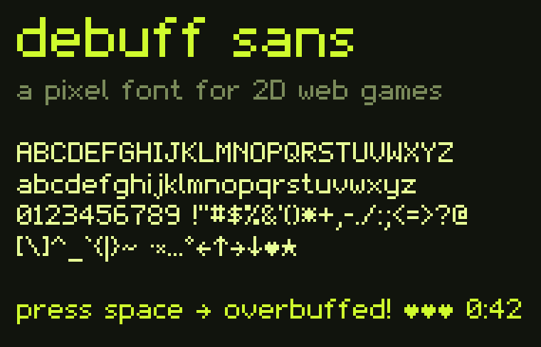

# debuff sans



A pixel font for 2D web games, made for [debuff](https://debuff.jp) and free for any project. Downloads: [debuffjp/debuff-sans releases](https://github.com/debuffjp/debuff-sans/releases/latest).

- Printable ASCII plus `· × … ° ← ↑ → ↓ ♥ ★` (105 glyphs).
- 5×7 capitals, 2-pixel descenders, proportional widths with 1 pixel of spacing.
- Comes as an outline font (TTF), a bitmap font (BDF) and a sprite sheet (PNG).

## Files

| File | Use it for |
| --- | --- |
| `debuff-sans.ttf` | CSS, design tools, any engine that loads TTF. One pixel is 100 units on a 1000-unit em, so it's crisp at **10px, 20px, 30px…** |
| `debuff-sans.bdf` | Bitmap-font tools and engines that read BDF |
| `debuff-sans.png` | Sprite-sheet engines and Aseprite: a 6×9 grid, white on transparent, in the order below |

Sheet order: space to `~` (ASCII 32–126), then `· × … ° ← ↑ → ↓ ♥ ★`. Each glyph starts at its cell's left
edge; its advance is its rightmost inked column + 1. A space advances 3 pixels.

## Use it

**CSS**

```css
@font-face {
  font-family: "debuff sans";
  src: url("debuff-sans.ttf") format("truetype");
}
.hud {
  font: 20px "debuff sans"; /* multiples of 10px stay pixel-perfect */
  -webkit-font-smoothing: none;
}
```

**debuff**: it's built in. `draw.text` uses it by default, and `debuffSans()` returns it as a `BitmapFont`.

**Other engines** (Phaser, PixiJS, KAPLAY, Godot, LÖVE…): load `debuff-sans.png` as a bitmap font with a 6×9
cell, or use the TTF at a multiple of 10px with smoothing off.

## Edit or build it

The glyphs are drawn as text in `glyphs.mjs`, so a change is a readable diff:

```js
A: [".###.", "#...#", "#...#", "#####", "#...#", "#...#", "#...#"],
```

- `node build.mjs` regenerates `debuff-sans.png` and the data built into `@debuffjp/core`.
- `node release.mjs` writes `dist/debuff-sans.ttf`, `dist/debuff-sans.bdf` and `specimen.png`.

## License

The font is licensed under the [SIL Open Font License 1.1](OFL.txt), with Reserved Font Name "debuff sans":
use it, embed it in games and apps, and modify it, including commercially. You can't sell the font on its
own, and a modified version needs a different name. Inside debuff's packages it also ships under debuff's
MIT license.

Made by [debuff](https://debuff.jp). Say hi on [Discord](https://discord.gg/jshbDHSpCY).
